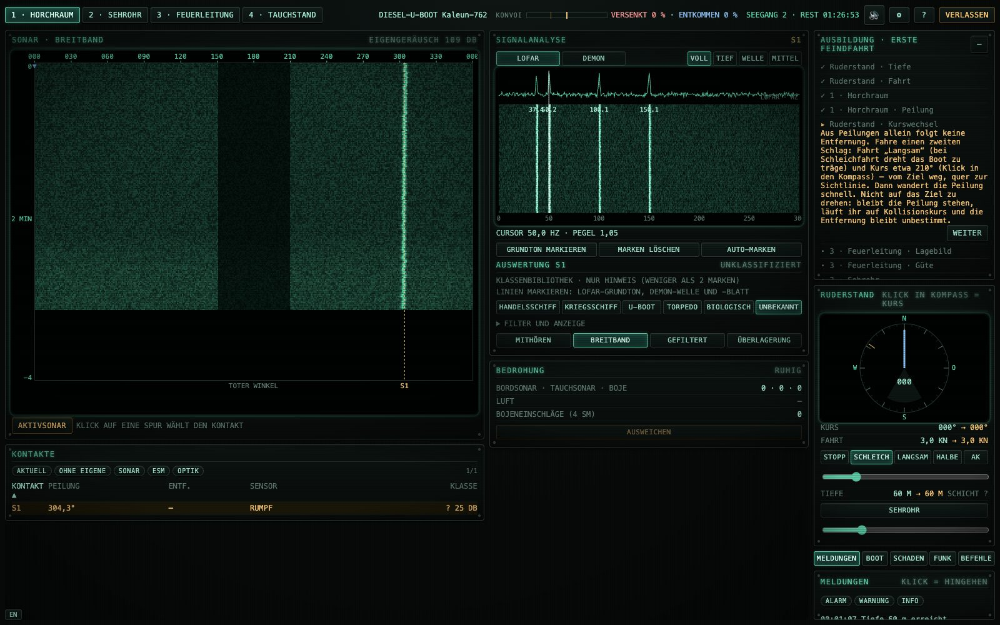
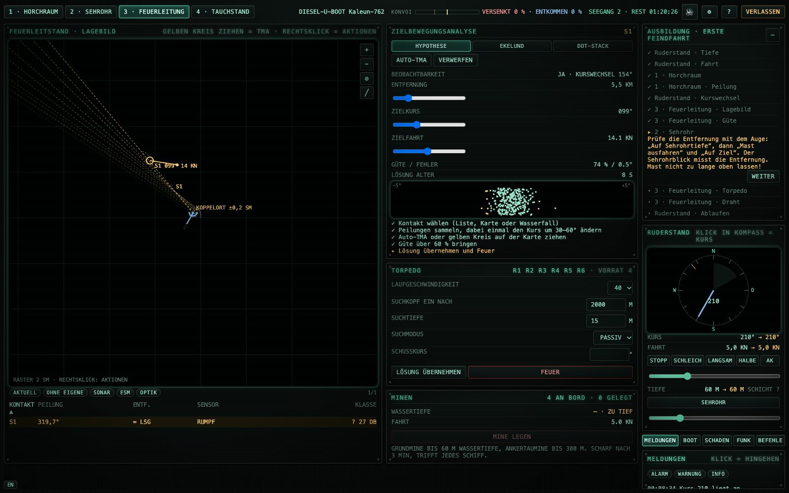
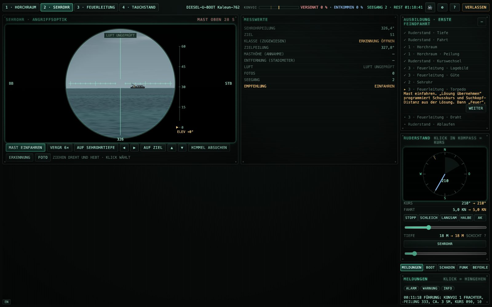
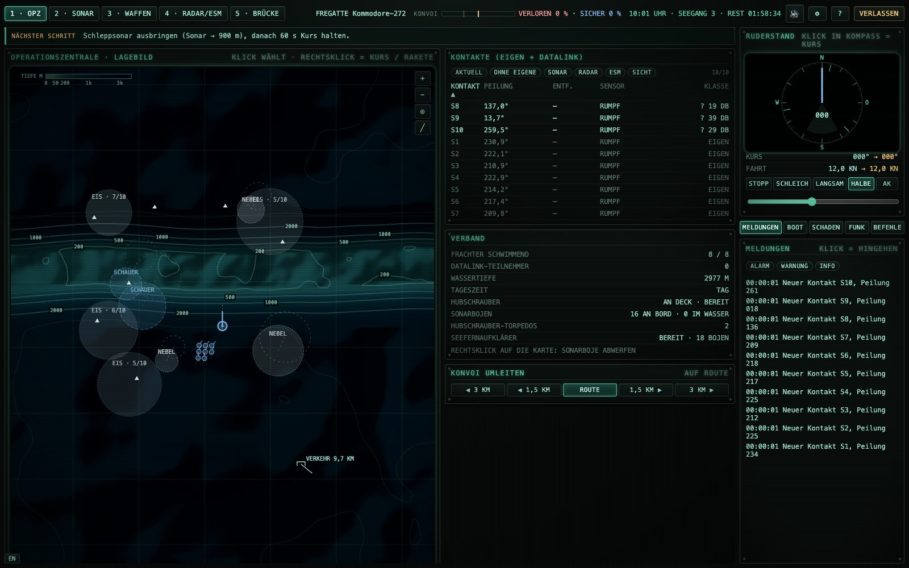
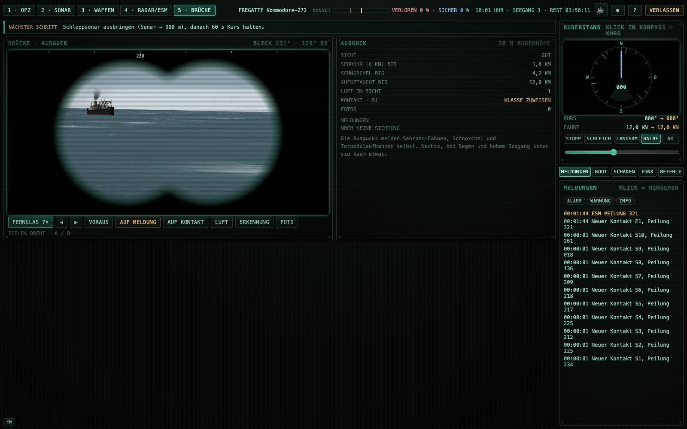
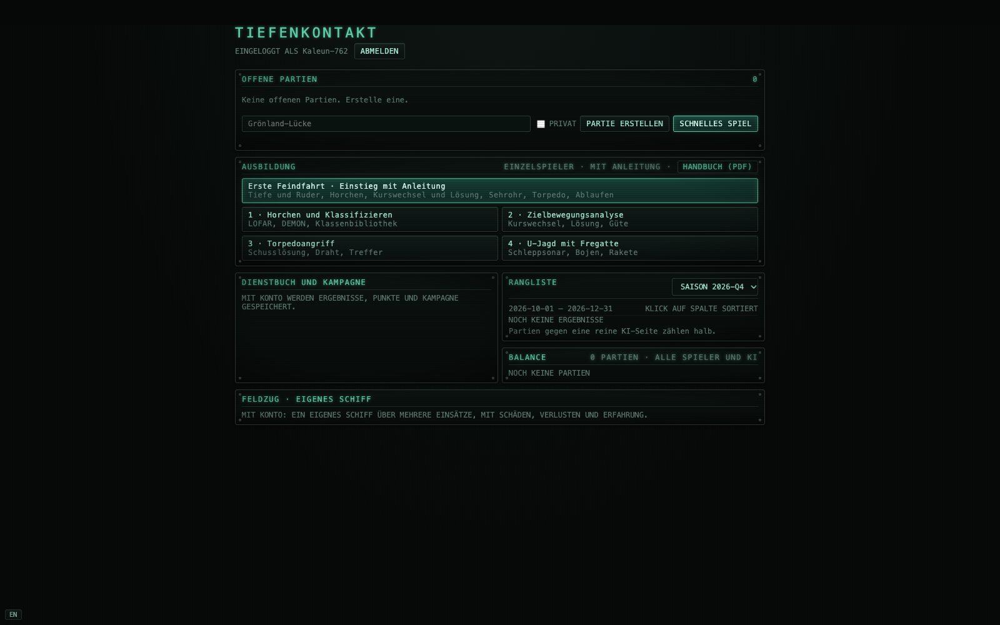

# Tiefenkontakt

[](https://github.com/db9979/tiefenkontakt/actions/workflows/ci.yml)

**Deutsch** · [English](#english)

Ein Multiplayer-U-Boot-Spiel im Browser, angesiedelt im Kalten Krieg. Wolfsrudel (U-Boote) kämpfen gegen den Geleitschutz (Fregatten) um einen KI-Konvoi. Gespielt wird mit echter Sonar-Simulation, Zielbewegungsanalyse (TMA), drahtgelenkten Torpedos, Funkpeilung, Minen und Sprachfunk. Freie Plätze übernimmt die KI. Dazu kommen eine Kampagne, Ranglisten mit Saisons und ein geführtes Einsteiger-Tutorial.

## Bilder aus dem Spiel · Screenshots

**U-Boot · Horchraum:** Im Sonar-Wasserfall zieht der Frachter als helle Spur. Rechts daneben stehen die Schmalband-Analyse (LOFAR), die Tutorial-Schritte und der Ruderstand.<br>
*Submarine · sonar room: the freighter's trace on the broadband waterfall, narrowband analysis (LOFAR), tutorial steps and helm.*



**U-Boot · Feuerleitung:** Aus Peilungen auf zwei Schenkeln ergibt sich die Lösung. Dazu kommen Entfernung, Kurs, Fahrt und Güte des Ziels, darunter die Torpedo-Programmierung.<br>
*Submarine · fire control: target motion analysis from bearings on two legs (range, course, speed, quality), torpedo settings below.*



**U-Boot · Sehrohr:** 3D-Angriffsoptik mit Strichplatte und Mast-Zeitmesser. Der Blick bestätigt das Ziel.<br>
*Submarine · periscope: 3D attack scope with reticle and mast timer; the look confirms the target.*



**Fregatte · Operationszentrale:** Das Lagebild zeigt Konvoi, Kontakte, Wetterzellen und Verkehr. Daneben stehen Kontaktliste, Verband und die Umleitung des Konvois.<br>
*Frigate · ops room: tactical picture with convoy, contacts, weather cells and traffic; contact list, task group and convoy detour.*



**Fregatte · Brücke:** Der Ausguck sieht durchs Fernglas auf den Konvoi.<br>
*Frigate · bridge: the lookout's binoculars on the convoy.*



**Lobby:** offene Partien, Ausbildung mit Tutorial, Dienstbuch, Rangliste mit Saisons.<br>
*Lobby: open matches, training with the tutorial, service record, seasonal rankings.*



Die Bilder erzeugt `npm run screenshots` neu, in echten Spielszenen mit Headless-Chrome.<br>
*The pictures are regenerated by `npm run screenshots` from real game scenes in headless Chrome.*

---

## Deutsch

### Voraussetzungen

- **Node.js 22** oder neuer (der Server nutzt das eingebaute `node:sqlite`)
- **npm** (kommt mit Node)
- Für den Betrieb: **Docker** mit Docker Compose (Linux, macOS, Raspberry Pi 4/5)
- Optional für den Browser-Test: Google Chrome oder Chromium

### Schnellstart zum Ausprobieren und Entwickeln

```bash
git clone https://github.com/db9979/tiefenkontakt.git
cd tiefenkontakt
npm install
npm run dev:server        # Spielserver auf http://localhost:8787
npm run dev:client        # in einem zweiten Terminal: Oberfläche auf http://localhost:5173
```

Dann http://localhost:5173 öffnen, „Als Gast“ wählen und in der Lobby **„Erste Feindfahrt“** starten. Dieses Tutorial führt Schritt für Schritt durch einen ersten Angriff.

Ohne Mailserver landen Bestätigungs- und Passwort-Links im Server-Log. Konten funktionieren also auch lokal.

### Betrieb mit Docker

```bash
cp .env.example .env      # Werte eintragen (siehe unten); .env nie committen
docker compose pull       # fertiges Image von ghcr.io (amd64 und arm64, also auch Raspberry Pi)
docker compose up -d
```

Selbst bauen statt herunterladen: `docker compose up -d --build`. Für eine feste Version setzt du in `.env` z. B. `TK_IMAGE=ghcr.io/db9979/tiefenkontakt:1.0.0` (die Versionen stehen unter *Releases*).

Das Spiel läuft danach auf http://localhost:8787, mit Server und fertig gebauter Oberfläche auf einem Port. Die Daten (Konten, Statistiken, laufende Partien, Backups) liegen im Docker-Volume `tiefenkontakt-data`.

Für den Betrieb im Internet gehört ein HTTPS-Reverse-Proxy davor, z. B. Caddy, nginx oder der Proxy einer Synology. Dabei in `.env` setzen:

```ini
PUBLIC_URL=https://dein-spiel.example.de
COOKIE_SECURE=1
```

Der Proxy muss WebSockets durchreichen, für die Pfade `/ws` und `/lk`.

### Raspberry Pi

Ein Raspberry Pi 5 trägt im Lasttest 30 gleichzeitige Partien und 144 Sprachfunk-Teilnehmer. Einrichtung vom eigenen Rechner aus:

```bash
ssh-copy-id user@raspberrypi.local                 # einmalig: Anmeldung per SSH-Schlüssel
./scripts/deploy-pi.sh user@raspberrypi.local      # kopiert den Code, baut und startet die Container
```

Das Skript legt beim ersten Mal eine `.env` aus `.env.example` an, erzeugt fehlende Geheimnisse (TURN, LiveKit) und überschreibt eine vorhandene `.env` nie. Weitere Aufrufe aktualisieren das Spiel.

Optional gibt es einen nächtlichen Balance-Test der KI mit Bericht per Mail:

```bash
./scripts/install-arena-cron.sh user@raspberrypi.local
```

Überwachung: Der Server mailt selbst bei fehlgeschlagenen Backups, wenig Platz, hohem Speicherverbrauch oder Verzögerungen (`ALERT_*` in `.env`, Empfänger `ALERT_TO`). Dass der Server ganz ausgefallen ist, merkt ein Cron-Job auf dem Host (alle 5 min, Neustart + Mail), dazu kommt sonntags ein Restore-Test des neuesten Backups:

```bash
./scripts/install-health-cron.sh user@raspberrypi.local
```

### Wichtige Einstellungen (`.env`)

| Variable | Bedeutung |
|---|---|
| `PUBLIC_URL` | Öffentliche Adresse, wird in Konto-Mails verwendet |
| `COOKIE_SECURE` | `1` hinter HTTPS, `0` nur für HTTP im LAN |
| `ADMIN` | Rufzeichen der Moderatoren, durch Kommas getrennt |
| `SMTP_*`, `MAIL_FROM` | Ausgehende Mail; Beispiele für Gmail und iCloud stehen in `.env.example` |
| `MAX_MATCHES` | Höchstzahl gleichzeitiger Partien (Standard 30) |
| `BACKUP_*` | Tägliche Datenbank-Sicherung, optional mit Zweitkopie auf NAS oder zweiter Platte |
| `COMPOSE_PROFILES` | `turn`, `sfu` oder `turn,sfu` für den Sprachfunk (siehe unten) |

### Sprachfunk

Der Sprachfunk hat drei Stufen:

1. **Ohne Einstellungen:** Die Browser sprechen direkt miteinander. Das klappt im LAN und hinter offenen Routern.
2. **`COMPOSE_PROFILES=turn`:** eigener TURN-Relay für strenge Router. Am Router UDP+TCP 3478 und UDP 49160–49200 weiterleiten.
3. **`COMPOSE_PROFILES=sfu`** (empfohlen, mit `LIVEKIT_URL=/lk`): Sprachserver LiveKit. Der Spielserver setzt die Funkregeln durch: Ein U-Boot funkt nur mit ausgefahrenem Mast, und die Reichweite hängt vom Wetter ab. Am Router TCP 7881 und UDP 7882 weiterleiten.

### Tests und Werkzeuge

```bash
npm test                  # Unit- und Integrationstests (vitest)
npm run typecheck         # TypeScript für Server, Simulation und Oberfläche
npm run e2e               # Browser-Ende-zu-Ende-Test (braucht Chrome; CHROME_PATH setzen, falls nötig)
npm run arena -- 90       # 90 Partien KI gegen KI: Balance-Bilanz pro Mission
npm run loadtest -- 10 60 # Lasttest: 10 Partien, 60 Sekunden
```

### Aufbau

| Ordner | Inhalt |
|---|---|
| `packages/shared` | Deterministische Simulation: Physik, Akustik, Sensoren, Waffen, TMA, Protokoll |
| `apps/server` | Node-Server: Lobby, Partien mit 10 Hz, KI-Kommandanten, Konten (SQLite), Kampagne, Sprachfunk-Rechte |
| `apps/client` | Oberfläche mit Vite, Canvas und three.js; Stationen für U-Boot und Fregatte, 3D-Sehrohr und Brücke |
| `scripts` | Deploy, Arena, Lasttest, Browser-Test, Handbuch-Generator |
| `docs/handbuch` | Spielhandbuch; das PDF wird unter `/handbuch.pdf` ausgeliefert |

### Lizenz

[MIT](LICENSE)

---

## English

<a id="english"></a>

A multiplayer submarine game for the browser, set in the Cold War. Wolf packs (submarines) fight the escort (frigates) over an AI convoy. It is played with a real sonar simulation, target motion analysis (TMA), wire-guided torpedoes, radio direction finding, naval mines and voice radio. The AI fills empty slots. There is also a campaign, seasonal rankings and a guided beginner tutorial. The game's interface is German, with a built-in English translation (EN/DE switch at the bottom left).

### Requirements

- **Node.js 22** or newer (the server uses the built-in `node:sqlite`)
- **npm** (ships with Node)
- To run it in production: **Docker** with Docker Compose (Linux, macOS, Raspberry Pi 4/5)
- Optional, for the browser test: Google Chrome or Chromium

### Quick start to try it out and develop

```bash
git clone https://github.com/db9979/tiefenkontakt.git
cd tiefenkontakt
npm install
npm run dev:server        # game server on http://localhost:8787
npm run dev:client        # in a second terminal: interface on http://localhost:5173
```

Then open http://localhost:5173, choose "Play as guest" and start **"First patrol"** in the lobby. This tutorial walks you through a first attack step by step.

Without a mail server, verification and password links go to the server log. So accounts work locally too.

### Running with Docker

```bash
cp .env.example .env      # fill in the values (see below); never commit .env
docker compose pull       # ready-made image from ghcr.io (amd64 and arm64, so Raspberry Pi too)
docker compose up -d
```

To build it yourself instead of downloading: `docker compose up -d --build`. For a fixed version set e.g. `TK_IMAGE=ghcr.io/db9979/tiefenkontakt:1.0.0` in `.env` (versions are listed under *Releases*).

The game then runs on http://localhost:8787, with the server and the built interface on one port. Data (accounts, statistics, running matches, backups) is kept in the Docker volume `tiefenkontakt-data`.

To run it on the internet, put an HTTPS reverse proxy in front, e.g. Caddy, nginx or a Synology's proxy. Set these in `.env`:

```ini
PUBLIC_URL=https://your-game.example.com
COOKIE_SECURE=1
```

The proxy must pass WebSockets through, on the paths `/ws` and `/lk`.

### Raspberry Pi

In the load test a Raspberry Pi 5 handles 30 simultaneous matches and 144 voice radio participants. Set it up from your own computer:

```bash
ssh-copy-id user@raspberrypi.local                 # once: log in with an SSH key
./scripts/deploy-pi.sh user@raspberrypi.local      # copies the code, builds and starts the containers
```

On the first run the script creates a `.env` from `.env.example`, generates missing secrets (TURN, LiveKit) and never overwrites an existing `.env`. Later runs update the game.

Optionally there is a nightly AI balance test that reports by mail:

```bash
./scripts/install-arena-cron.sh user@raspberrypi.local
```

Monitoring: the server itself mails on failed backups, low disk, high memory or lag (`ALERT_*` in `.env`, recipient `ALERT_TO`). A host cron job notices when the server is down altogether (every 5 min, restart + mail), and every Sunday the newest backup gets a restore test:

```bash
./scripts/install-health-cron.sh user@raspberrypi.local
```

### Main settings (`.env`)

| Variable | Meaning |
|---|---|
| `PUBLIC_URL` | Public address, used in account mails |
| `COOKIE_SECURE` | `1` behind HTTPS, `0` only for plain HTTP in the LAN |
| `ADMIN` | Callsigns of the moderators, comma-separated |
| `SMTP_*`, `MAIL_FROM` | Outgoing mail; examples for Gmail and iCloud are in `.env.example` |
| `MAX_MATCHES` | Maximum number of simultaneous matches (default 30) |
| `BACKUP_*` | Daily database backup, optionally with a second copy on a NAS or second disk |
| `COMPOSE_PROFILES` | `turn`, `sfu` or `turn,sfu` for voice radio (see below) |

### Voice radio

Voice radio has three levels:

1. **Nothing set:** the browsers talk to each other directly. This works in the LAN and behind open routers.
2. **`COMPOSE_PROFILES=turn`:** your own TURN relay for strict routers. On the router, forward UDP+TCP 3478 and UDP 49160–49200.
3. **`COMPOSE_PROFILES=sfu`** (recommended, with `LIVEKIT_URL=/lk`): LiveKit voice server. The game server enforces the radio rules: a submarine can only transmit with its mast raised, and range depends on the weather. On the router, forward TCP 7881 and UDP 7882.

### Tests and tools

```bash
npm test                  # unit and integration tests (vitest)
npm run typecheck         # TypeScript for server, simulation and interface
npm run e2e               # browser end-to-end test (needs Chrome; set CHROME_PATH if needed)
npm run arena -- 90       # 90 AI-vs-AI matches: balance per mission
npm run loadtest -- 10 60 # load test: 10 matches, 60 seconds
```

### Layout

| Folder | Contents |
|---|---|
| `packages/shared` | Deterministic simulation: physics, acoustics, sensors, weapons, TMA, protocol |
| `apps/server` | Node server: lobby, matches at 10 Hz, AI captains, accounts (SQLite), campaign, voice radio permissions |
| `apps/client` | Interface with Vite, canvas and three.js; stations for submarine and frigate, 3D periscope and bridge |
| `scripts` | Deploy, arena, load test, browser test, handbook generator |
| `docs/handbuch` | Game handbook (German); the PDF is served at `/handbuch.pdf` |

### License

[MIT](LICENSE)
